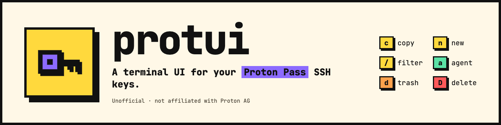

<picture>
  <source media="(prefers-color-scheme: dark)" srcset="docs/assets/banner-dark.png">
  
</picture>

> **protui is not affiliated with, endorsed by, or supported by Proton AG.**
> It is an unofficial front-end that drives the official `pass-cli` binary.
> Proton Pass is a trademark of Proton AG.

## Requires `pass-cli`

protui does not talk to Proton's servers. It shells out to the official
[Proton Pass CLI](https://protonpass.github.io/pass-cli/) for everything, so
that binary must be installed **and authenticated** before protui will start.

```sh
# macOS
brew install protonpass/tap/pass-cli

# then, once
pass-cli login
```

If either step is missing, protui exits immediately with a message telling you
which one — it will not open a UI you cannot use.

Verify with:

```sh
pass-cli info
```

## Install

### Prebuilt binary

Download the archive for your platform from the
[latest release](https://github.com/nxplain-sh/protui/releases/latest):

| Platform             | Archive                                              |
| -------------------- | ---------------------------------------------------- |
| macOS, Apple silicon | `protui_<version>_aarch64-apple-darwin.tar.gz`       |
| macOS, Intel         | `protui_<version>_x86_64-apple-darwin.tar.gz`        |
| Linux, x86-64        | `protui_<version>_x86_64-unknown-linux-musl.tar.gz`  |
| Linux, ARM64         | `protui_<version>_aarch64-unknown-linux-musl.tar.gz` |

The Linux binaries are statically linked, so they run on any distribution.
Windows is not supported.

Each release also carries `checksums.txt`. Download it beside the archive,
check, unpack, and put `protui` somewhere on your `PATH`:

```sh
shasum -a 256 --check --ignore-missing checksums.txt # sha256sum on Linux
tar -xzf protui_<version>_<target>.tar.gz
mv protui_<version>_<target>/protui ~/.local/bin/
```

The binaries are not signed. On macOS, one downloaded with a browser is
quarantined and Gatekeeper refuses to run it; clear that with
`xattr -d com.apple.quarantine ~/.local/bin/protui`.

### For Rust developers

Building from source needs Rust 1.88 or newer:

```sh
cargo install --locked --git https://github.com/nxplain-sh/protui protui
```

Or from a clone:

```sh
cargo xtask build   # → target/release/protui
cargo xtask install # → ~/.cargo/bin/protui
```

## Use

```sh
protui
```

Navigation is vim's, with vim's semantics and vim's modifiers:

| Key               | Action                                               |
| ----------------- | ---------------------------------------------------- |
| `j` `k`           | move down / up                                       |
| `gg` `G`          | jump to top / bottom                                 |
| `Ctrl-f` `Ctrl-b` | page down / up                                       |
| `Ctrl-d` `Ctrl-u` | half page down / up                                  |
| `/`               | fuzzy filter by title, vault, comment or fingerprint |

Actions follow lazygit and k9s — one mnemonic letter each:

| Key       | Action                                                   |
| --------- | -------------------------------------------------------- |
| `c` / `y` | copy the selected public key to the clipboard            |
| `n`       | generate a new key                                       |
| `d`       | move to trash — recoverable with `pass-cli item untrash` |
| `D`       | delete permanently — no undo, requires typing the title  |
| `a`       | SSH agent daemon: status, start, stop                    |
| `r`       | reload from `pass-cli`                                   |
| `?`       | expand the help bar                                      |
| `q`       | quit                                                     |

There is no `dd` or `yy`: vim's doubling exists to disambiguate an operator
from a motion, and a list has one object under the cursor and no motions. The
reasoning is in
[the keymap decision record](docs/adr/0010-navigate-like-vim-act-with-mnemonics.md).

Keys from every vault are listed together, with the vault shown per row.

`Ctrl-e` and `Ctrl-y` scroll the detail pane when a key is too long to fit,
without moving the cursor — as in vim.

### Colours

protui asks the terminal for its background and picks a light or dark palette
to match. Where the terminal does not answer — tmux or screen without
passthrough, some SSH setups — it assumes dark; set `PROTUI_THEME=light` or
`PROTUI_THEME=dark` to choose. Without truecolor (`COLORTERM=truecolor`) it
uses the nearest 256 colours, and [`NO_COLOR`](https://no-color.org) turns
colour off.

### Copying needs a clipboard

On macOS this works out of the box. On Linux, copying shells out to `xclip`,
`xsel` or `wl-copy`, so one of them has to be installed:

```sh
sudo apt install xclip      # X11
sudo apt install wl-clipboard  # Wayland
```

Copying will not work over a plain SSH session with no display, since there is
no clipboard to write to. protui reports the failure rather than pretending it
worked; the public key is on screen and can be selected with the mouse.

### Trashing and deleting

`d` moves a key to the trash. protui lists only active keys, so it disappears
from the list — restore it from the CLI:

```sh
pass-cli item list --vault-name <vault> --filter-state trashed
pass-cli item untrash --share-id <id> --item-id <id>
```

`D` destroys the key outright. There is no undo and no trash copy, which is why
it asks you to type the title.

### Generating a key

`n` opens a form for the title, vault, algorithm (`ed25519` by default, or
`rsa2048` / `rsa4096`), an optional comment, and an optional passphrase.

The comment is stored **inside the public key line itself** rather than as a
separate field, because that is the only place upstream keeps it.

## Security

- **No private key ever reaches protui.** The one upstream call that returns
  private key material — `pass-cli item view --output json` — is never used.
  Public keys are read with `item view --field public_key`, which returns
  exactly one field. There is no code path in protui that names the private key.
- **Nothing secret is passed as a command-line argument.** Arguments are visible
  to any user on the machine via `ps`. A passphrase, when you set one, is
  handed to `pass-cli` through the `PROTON_PASS_SSH_KEY_PASSWORD` environment
  variable instead. protui holds it in exactly one buffer, allocated up front
  so typing never leaves stale copies behind, and zeroes it once the child
  process has it. (The standard library copies the child's environment while
  spawning it, and that copy cannot be wiped; it is freed as soon as the child
  has started. It is never written to argv, disk, or logs.)
- **No inherited passphrase.** `PROTON_PASS_SSH_KEY_PASSWORD` and
  `PROTON_PASS_SSH_KEY_PASSWORD_FILE` are stripped from the environment
  `pass-cli` inherits, so one exported in your shell cannot silently protect a
  key you created without a passphrase.
- **No value can be mistaken for a flag.** Every value protui passes — a title,
  a comment, an id — is attached to its flag as `--flag=value`, so one that
  begins with `-` is read as the value it is.
- **`--show-secrets` is never passed.** protui reads only the redacted item
  summary, which upstream guarantees carries no user secret material.
- **The UI displays public keys and fingerprints only.**
- Fingerprints and algorithms are computed locally from the public key, so
  deriving them requires no additional secret access.
- **Text from Proton Pass is sanitised before it is drawn.** Item titles, vault
  names and key comments are user-authored, and Proton Pass supports sharing
  items and vaults, so they can have been written by somebody else. Drawn
  unfiltered into a terminal such a string is not data but instructions: it can
  clear the screen, rewrite the window title, or — via OSC 52, which xterm,
  kitty, iTerm2, WezTerm and foot all honour — **write to your clipboard**,
  which matters here because putting a key on the clipboard is what protui is
  for. Terminal escape sequences and bidirectional overrides are stripped at
  the point the text enters, in `src/passcli`.
- **No `unsafe` code.** The crate forbids it, so memory safety is the
  compiler's guarantee rather than a reviewer's.
- **Dependencies are checked in CI** with
  [cargo-deny](https://github.com/EmbarkStudios/cargo-deny) against the
  [RustSec](https://rustsec.org) advisory database, alongside a licence and
  source policy, and clippy runs with every warning treated as an error.

## How it fits together

```
src/main.rs       entry point; preflight checks, then hands off to the UI
src/passcli/      the only module that runs pass-cli
src/keys/         domain types, independent of the upstream JSON shape
src/ui/           the ratatui interface; the update loop does no I/O
```

`src/passcli` is the single seam against upstream. Everything else depends on
it rather than on `std::process`, so an upstream change is contained to one
module.

The reasoning behind these choices — and the ones that are not visible in the
code, like why `pass-cli item view --output json` is never called — is recorded
in [`docs/adr/`](docs/adr/README.md).

## The upstream schema

`pass-cli` serialises its internal Rust structs directly, and its JSON output is
**not a documented stable contract**. [`docs/schema.md`](docs/schema.md) records
the exact shape protui parses — verified against both the upstream source and a
live binary, with the version and commit it was captured from — so it can be
diffed when upstream changes.

Some things that document will save you from guessing:

- SSH key items store only `private_key`, `public_key` and `sections`. There is
  no algorithm, fingerprint, or comment field.
- `item list` cannot span vaults; protui fans out per vault.
- Timestamps have no timezone, so an RFC 3339 parser will not accept them.
- Casing is inconsistent within a single object: `item_type` is snake_case,
  `state` and `flags` are PascalCase, and the CLI flag is kebab-case.

Unknown JSON fields are ignored rather than fatal, so an upstream addition will
not break the list. A removed or renamed field is caught by validating that
required fields are present, and reported as an error naming the command that
produced it.

## Development

```sh
cargo xtask check    # lint, format-check, test, audit — mirrors CI
cargo xtask test     # tests only
cargo xtask coverage # line coverage; HTML in target/llvm-cov/html
cargo xtask fmt      # rustfmt the Rust, prettier the Markdown, JSON and YAML
cargo run            # build and launch
```

`cargo xtask help` lists every task. The tasks live in [`xtask/`](xtask/), a
small std-only crate in the workspace, following the
[cargo xtask](https://github.com/matklad/cargo-xtask) convention: they need
nothing but cargo, and CI and the pre-commit hook run the same ones.

Development, CI and releases all use the Rust pinned in
[`rust-toolchain.toml`](rust-toolchain.toml), the latest stable, which Renovate
keeps current; rustup installs it on first use. CI runs the same checks on push
and pull request, across Linux and macOS, and again on the minimum supported
Rust — see
[`.github/workflows/ci.yml`](.github/workflows/ci.yml).

Rust code is formatted by `rustfmt` and linted by clippy, pedantic lints
included, with warnings as errors; Markdown, JSON and YAML are formatted by
[prettier](https://prettier.io). The code follows the
[Rust Style Guide](https://doc.rust-lang.org/stable/style-guide/) and
[Google's Rust style guide](https://google.github.io/styleguide/rustguide.html).
`cargo-deny` is used when installed and skipped with a note when not.

Dependency updates come from [Renovate](https://docs.renovatebot.com),
configured in [`renovate.json`](renovate.json). ratatui and crossterm update
together in one pull request, and nothing merges itself — every update is
reviewed.

Architectural changes should come with a record in
[`docs/adr/`](docs/adr/README.md) — see its README for what earns one.

Tests for the parsing layer are table-driven over fixture JSON in
`src/passcli/testdata/`. Those fixtures are recorded `pass-cli` output and
are excluded from prettier so they stay byte-for-byte as captured.

To eyeball the UI without a Proton session, render every screen with colour
forced on:

```sh
cargo xtask preview
PROTUI_PREVIEW_LIGHT=1 cargo xtask preview
```

It asserts nothing and is skipped by default — it exists so layout changes can
be checked against a light and a dark terminal before they ship.

## Scope

v1 handles SSH keys only: listing, generating, viewing, copying, trashing,
deleting, and the SSH agent daemon. Logins, notes, TOTP, aliases, secret
injection and vault management are out of scope — use `pass-cli` directly.

## Contributing

See [CONTRIBUTING.md](CONTRIBUTING.md). It covers the setup, the checks, and the
handful of security properties a change must not break.

Vulnerabilities go through [SECURITY.md](SECURITY.md), not the issue tracker.

Changes are recorded in [CHANGELOG.md](CHANGELOG.md).

## Licence

MIT. See [LICENSE](LICENSE).
